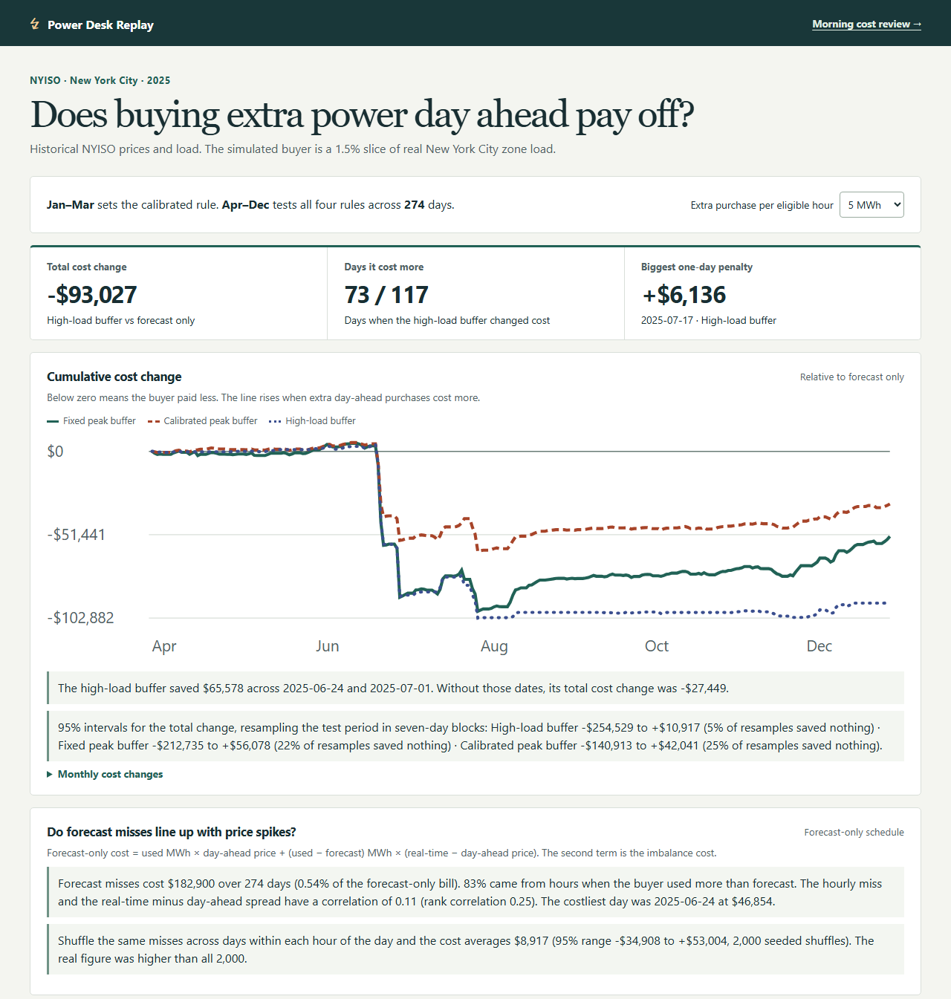

# Power Desk Replay

Power Desk Replay follows two decisions a power analyst faces. The historical study tests whether to buy extra power in the day-ahead market. The morning review walks through when to hold the daily cost report and how to trace a variance to the hourly inputs.

**Live:** [historical study](https://domcity2003.github.io/power-desk-replay/study.html) · [morning cost review](https://domcity2003.github.io/power-desk-replay/) — both run in the browser with no install.

## Historical study

The simulated buyer takes 1.5% of real NYC zone load (about 87 MWh an hour), using NYISO's actual integrated load and its day-before load forecast for 2025. Over 274 evaluation days its forecast misses cost **$182,900**, and they were not random. Shuffling the same misses across days gives an average of $8,917; the real figure beat all 2,000 shuffles. A buffer that fires only when the load forecast is high saved the most (**$93,027, 0.27%**) but its 95% interval, −$254,529 to +$10,917, still reaches zero and two heat-wave days supply most of the gain. The memo recommends keeping the forecast-only schedule and paper-trading the high-load rule. A fixed weekday peak buffer saved $52,452 and raised costs on 125 of the 197 days it changed the bill.

- [Read the case study](STUDY.md) for the recommendation, the forecast-error analysis, and the assumptions.
- Open the [live study](https://domcity2003.github.io/power-desk-replay/study.html), or [study.html](study.html) locally. The data it needs is bundled in [data/study-data.js](data/study-data.js), derived from NYISO's public day-ahead and real-time price, actual load and load forecast archives.
- To rebuild that file from the official archives on Windows, install Node.js 22+ and run `powershell -ExecutionPolicy Bypass -File download-study.ps1`. The test suite checks that the bundled file matches the source fingerprint and reproduces the memo's headline numbers.

## Try the review

Open the [live review](https://domcity2003.github.io/power-desk-replay/) (or [index.html](index.html) locally) for the simulated PJM Western Hub review.

1. Choose **Cold snap**. At 18:00 Eastern, the buyer used 130 MWh after scheduling 108 MWh. The extra 22 MWh at $480/MWh cost $10,560. Add $7,776 for the day-ahead purchase and the hour comes to **$18,336**.
2. Choose **Broken inputs**. The daily total is withheld. In **Input review & sign-off**, apply the confirmed 17:00 schedule and then restore the 18:00 demo price. With only one correction, the report stays on hold.
3. Sign off with a name and download the hourly CSV. The two corrections and the sign-off appear in the review history. Reloading the page starts a fresh review.

## How the estimate works

Each hour includes the scheduled purchase at the day-ahead price and the difference between usage and schedule at the real-time price. A price spike can pass review if its input record is present and valid. The change versus the normal day is split into price and volume effects for each purchase component. The calculation applies the price change first, so the volume effect includes the interaction between the two.

All bundled prices, volumes, and correction records are fictional. Winter Storm Fern provided the context for the cold-weather case. The model estimates hourly energy costs. PJM settles real time in five-minute intervals and its bills include additional charges. [PJM winter operations review](https://insidelines.pjm.com/pjm-reviews-january-cold-weather-operations/) · [PJM settlement manual](https://www.pjm.com/-/media/DotCom/documents/manuals/m28.ashx)

## Check the math

Run `node --test` with Node.js 22 or newer. The tests cover settlement math, the price and volume breakdown, sign-off controls, source validation, whether the study's rules use future data, and the forecast-error cost identity.

[Build plan and sources](BUILD_PLAN.md)
