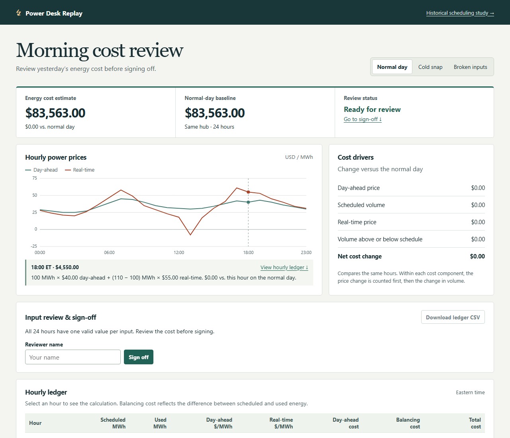

# Power Desk Replay

Power Desk Replay follows two decisions a power analyst faces. The historical study tests whether to buy extra power in the day-ahead market. The morning review walks through when to hold the daily cost report and how to trace a variance to the hourly inputs.

## Historical study

On 274 evaluation days in 2025, buying 5 MWh extra in every weekday peak hour reduced a simulated NYC buyer’s energy cost by **$52,452 (0.15%)**. It also raised costs on 125 of the 197 days it changed the bill. A rule calibrated on January–March saved less. A block bootstrap puts the 95% interval at −$212,735 to +$56,078, so the saving is not distinguishable from zero and the memo recommends keeping the forecast-only schedule. The case study traces the difference to actual NYISO prices and shows how much of the benefit came from a few days.

- [Read the case study](STUDY.md) for the recommendation, the strongest counterexample, and the assumptions.
- Open [study.html](study.html) in a browser. The New York City prices it needs are bundled in [data/study-data.js](data/study-data.js), derived from NYISO's public day-ahead and real-time zonal archives.
- To rebuild that file from the official archives on Windows, install Node.js 22+ and run `pwsh -File download-study.ps1`. The test suite checks that the bundled file matches the source fingerprint and reproduces the memo's headline totals.

## Try the review

Open [index.html](index.html) for the simulated PJM Western Hub review. It runs locally with no install.

1. Choose **Cold snap**. At 18:00 Eastern, the buyer used 130 MWh after scheduling 108 MWh. The extra 22 MWh at $480/MWh cost $10,560. Add $7,776 for the day-ahead purchase and the hour comes to **$18,336**.
2. Choose **Broken inputs**. The daily total is withheld. In **Input review & sign-off**, apply the confirmed 17:00 schedule and then restore the 18:00 demo price. With only one correction, the report stays on hold.
3. Sign off with a name and download the hourly CSV. The two corrections and the sign-off appear in the review history. Reloading the page starts a fresh review.

## How the estimate works

Each hour includes the scheduled purchase at the day-ahead price and the difference between usage and schedule at the real-time price. A price spike can pass review if its input record is present and valid. The change versus the normal day is split into price and volume effects for each purchase component. The calculation applies the price change first, so the volume effect includes the interaction between the two.

All bundled prices, volumes, and correction records are fictional. Winter Storm Fern provided the context for the cold-weather case. The model estimates hourly energy costs. PJM settles real time in five-minute intervals and its bills include additional charges. [PJM winter operations review](https://insidelines.pjm.com/pjm-reviews-january-cold-weather-operations/) · [PJM settlement manual](https://www.pjm.com/-/media/DotCom/documents/manuals/m28.ashx)

## Check the math

Run `node --test` with Node.js 22 or newer. The tests cover settlement math, the price and volume breakdown, sign-off controls, source validation, and whether the study uses future data to set the rule.

[Build plan and sources](BUILD_PLAN.md)
